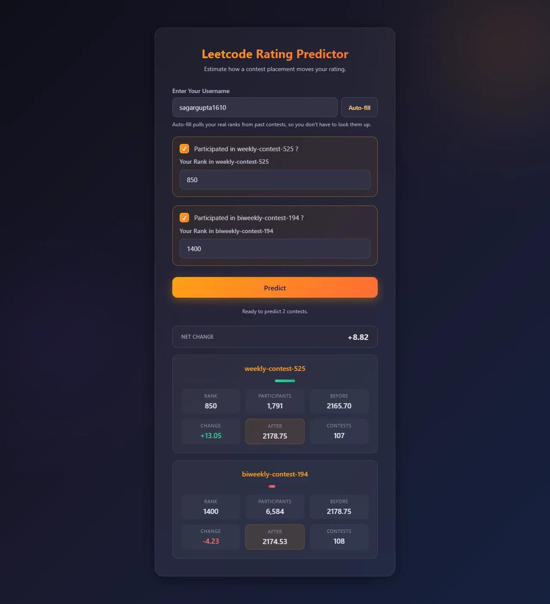
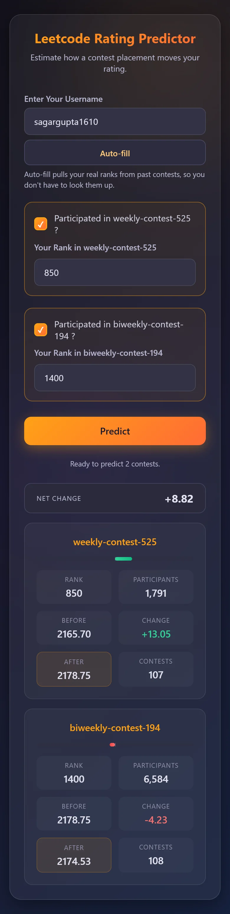
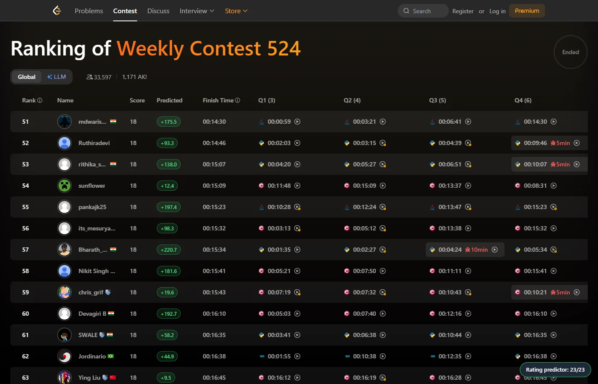

# LeetCode Contest Rating Predictor


**[View Live Demo](https://leetcode-rating-predictor.onrender.com/)** -- free-tier instance: a cold start took 31 s on 2026-10-18 (0.3 s once warm). It is kept awake on contest days, see [CI Pipeline](#ci-pipeline).

[](https://render.com/deploy?repo=https://github.com/Sagargupta16/LeetCode_Rating_Predictor)

[](https://python.org)
[](https://fastapi.tiangolo.com)
[](https://react.dev)
[](https://numpy.org)
[](LICENSE)

Predict your LeetCode contest rating change from your rank, with a Dense neural network trained on 242,108 contest records (the dataset holds 295,899 records from 8,182 users; the rest are held out by user). Use the web app (enter a username, hit **Auto-fill** to pull your real ranks) or the [browser extension](#browser-extension), which adds a **Predicted** column to every LeetCode contest ranking page and runs the model in your browser. The model is published on the Hugging Face Hub as [`sagargupta16/leetcode-rating-predictor`](https://huggingface.co/sagargupta16/leetcode-rating-predictor).

On recent contests of users the model never trained on, it is off by **9.11 and 7.58 rating points** on average in two samples of 50 users, and gets the direction of the change right 90.8% and 90.6% of the time. See [Performance](#performance).

| Web app (desktop) | Web app (phone) |
|---|---|
|  |  |



The trained network is a small Dense stack, so the API evaluates it with NumPy against exported weights. Serving needs no TensorFlow, Keras, scikit-learn or joblib: the runtime environment is ~65 MB instead of ~1.8 GB, and those frameworks are only required to retrain.

## Quick Start

```bash
# Clone and set up
git clone https://github.com/Sagargupta16/LeetCode_Rating_Predictor.git
cd LeetCode_Rating_Predictor

# Python environment
python -m venv venv
venv\Scripts\activate       # Windows
# source venv/bin/activate  # Linux/Mac

# Install and run -- no ML framework needed to serve predictions
pip install -r requirements.txt
python main.py
# Open http://localhost:8000
```

Retraining or re-exporting the model additionally needs `pip install -r requirements-ml.txt`.

## Why

LeetCode only publishes rating changes once a contest has been rated, well after
it ends. This predicts the change from your rank as soon as you know it, using a
model trained on real contest histories rather than a hand-tuned Elo formula.

LeetCode's rating is an Elo-style formula, and an exact replica needs the rating
of every participant: a ranklist scrape of 30k+ rows per contest. This model
needs only one user's own history, so the API answers a prediction with one
GraphQL call, and the extension can annotate any ranking page on demand. The
trade-off is accuracy: an exact replica gets close to zero error, this is 7 to 9
points off on average.

## Architecture

<picture>
  <source media="(prefers-color-scheme: dark)" srcset="docs/diagrams/architecture-dark.svg">
  <source media="(prefers-color-scheme: light)" srcset="docs/diagrams/architecture-light.svg">
  
</picture>

<picture>
  <source media="(prefers-color-scheme: dark)" srcset="docs/diagrams/ml-lifecycle-dark.svg">
  <source media="(prefers-color-scheme: light)" srcset="docs/diagrams/ml-lifecycle-light.svg">
  
</picture>

The specs behind the pictures are [`docs/diagrams/architecture.yaml`](docs/diagrams/architecture.yaml) and [`docs/diagrams/ml-lifecycle.yaml`](docs/diagrams/ml-lifecycle.yaml), rendered with [orrery](https://github.com/Sagargupta16/orrery).

- FastAPI serves both the API and the built React client, so production is one
  process on one origin. The Vite dev server (port 3000) talks to the API on
  port 8000.
- The API fetches all LeetCode data via **GraphQL** (the REST ranking API is
  blocked for servers; the extension reads it in the browser).
- Training and serving are split: TensorFlow is only needed offline, and the
  served model is plain NumPy (see [Serving](#serving)).
- The extension does not call the API. It reads histories from LeetCode GraphQL
  on the page's own origin and runs `model.json` from the Hugging Face Hub, so
  it has no cold start and no shared rate limit (see
  [Browser Extension](#browser-extension)).

### Design decisions

| Decision | Why |
|----------|-----|
| Dense network, not LSTM | Inputs are 15 tabular features per contest, not a sequence |
| NumPy inference instead of TensorFlow | Runtime env drops from ~1.8 GB to ~65 MB, and a golden test pins the output |
| One feature module (`app/services/features.py`) for the API and the backtest | The backtest scores the exact code that is served, and a test rebuilds the training record and checks all 15 features match |
| Participant-count features (3, 4, 13) built by the training formula at serve time | Train/serve skew on participant count tripled the backtest error (see [Performance](#performance)) |
| Train/test split by user, not by record | A random record split puts one user's contests on both sides and flatters the test score |
| Huber loss instead of MSE | First contests swing 100+ points; Huber keeps those from dominating, and it won both backtests |
| Extension runs the model itself, with `model.json` from the Hub | No Render cold start and no 30/min limit shared by every user; a retrain reaches every install without a store release; a parity test pins the JavaScript to the Python features |
| Training data on the Hugging Face Hub, not in git | No 100 MB per-file cap and no 65 MB JSON diffs in history; the same 295,899 records are 15 MB as Parquet against 68 MB as JSON |
| Retention floor on the data refresh | A throttled fetch once opened a PR that halved the training set |
| Hash-pinned lockfiles (`uv.lock`, `requirements*.lock.txt`) | Docker installs with `--require-hashes` |

## Project Structure

```
main.py                          # FastAPI entry point
app/                             # Backend package
  config.py                      #   Environment variables, constants
  schemas.py                     #   Pydantic request/response models
  model_loader.py                #   NumPy Dense network + scaler loader
  services/
    features.py                  #   History summary + 15-feature vector (API and backtest)
    leetcode.py                  #   LeetCode GraphQL client
    prediction.py                #   Prediction + output sanity bounds
  utils/
    cache.py                     #   TTLCache / RedisCache
    ratelimit.py                 #   Per-IP fixed-window rate limiting
scripts/
  train.py                       # Retrain with a by-user split -> model.keras, models/metrics.json
  export_model.py                # model.keras/scaler.save -> models/*.npz|json
  backtest.py                    # Score the served model on recent, unseen contests
  package_extension.py           # Zip extension/ for the Chrome Web Store
  update_data.py                 # Fetch training data from LeetCode
  export_dataset.py              # Records -> Parquet split by user -> Hub dataset repo
  publish_model.py               # models/ -> model.json + model card -> Hub model repo
  make_parity_fixture.py         # Python outputs the extension's JS port is tested against
  check.py                       # Smoke test the running API
notebooks/
  LC_Contest_Rating_Predictor.ipynb  # Original training notebook (random split)
data/                            # usernames.json (the records live on the Hub)
models/                          # Exported weights + scaler (API), model.json (extension), metrics.json
docs/                            # backtest.md (refreshed weekly), screenshots, diagrams/ (orrery specs + SVGs)
extension/                       # Chrome extension (17 tests, no build step)
tests/                           # 72 backend tests, fixtures/ for the extension parity check
client/                          # React frontend (19 tests)
```

## API

### `POST /api/predict`

```json
{
  "username": "your_username",
  "contests": [
    { "name": "weekly-contest-490", "rank": 1500 }
  ]
}
```

**Response:**

```json
[
  {
    "contest_name": "weekly-contest-490",
    "prediction": 25.5,
    "rating_before_contest": 1800,
    "rank": 1500,
    "total_participants": 42002,
    "rating_after_contest": 1825.5,
    "attended_contests_count": 45,
    "actual_change": null
  }
]
```

Contests are scored in order, each one starting from the rating the previous
one predicts. A contest LeetCode has already rated is the exception: its
change is already in the current rating, so it is scored from the history as
it stood before that contest (the same replay `scripts/backtest.py` uses),
does not move the chain, and `actual_change` carries the change LeetCode
applied. A request takes at most 20 contests.

Accounts that exist but have no rated contest yet are predicted from a 1500
rating and an empty history, which is how the training data starts every user.
Unknown usernames return `400`.

### `GET /api/userContests/{username}`

Returns the user's recent attended contests with the ranks they actually got, so
the UI can prefill the form instead of asking people to look their own
placements up:

```json
[
  {
    "name": "weekly-contest-490",
    "title": "Weekly Contest 490",
    "rank": 742,
    "rating_after": 1825.5
  }
]
```

Only contests whose slug matches `(weekly|biweekly)-contest-<n>` are returned,
so results can be posted straight back to `/api/predict`.

### `GET /api/contestData`

Returns the two most recent finished contests (GraphQL `pastContests`) and the
next two (`topTwoContests`), oldest first, so the form offers the contest that
just ended as well as the upcoming ones.

### `GET /api/health`

Health check with model/scaler/client status.

### Rate limiting

`/api/predict`, `/api/userContests/{username}` and `/api/contestData` share a
budget of 30 requests per minute per client IP by default
(`RATE_LIMIT_REQUESTS` / `RATE_LIMIT_WINDOW`), and return `429` with a
`Retry-After` header once exceeded. The client IP comes from
`CLIENT_IP_HEADER` (Cloudflare's `CF-Connecting-IP` by default, which fronts
Render), else the socket peer; `X-Forwarded-For` is ignored because callers
can set its first entry to anything.

## Browser Extension

`extension/` is a Manifest V3 Chrome extension. On any
`leetcode.com/contest/<slug>/ranking/` page it adds a **Predicted** column next
to Score with each visible user's predicted rating change, and follows the
page's own pagination.

- **Ranks** come from the JSON the ranking page itself loads
  (`/contest/api/ranking/<slug>/?pagination=<n>`), which works in the browser
  even though LeetCode blocks it for servers. Its `rank` is zero-based, so the
  extension adds 1 to match the page. leetcode.cn accounts are skipped, since
  their histories are not on leetcode.com; their rows get an empty cell so the
  columns after Score stay lined up.
- **Histories** come from LeetCode GraphQL (`/graphql/`), requested from the
  ranking page itself, so they are same-origin like the site's own calls. At
  most 2 are in flight, a 429 waits out `Retry-After`, and each history is
  cached for an hour in the browser session.
- **Predictions** run in the browser. `core.js` rebuilds the same 15 features
  the API does and runs the Dense network from `model.json`; a contest LeetCode
  already rated is scored from the history before it, and the tooltip shows the
  change LeetCode applied. `extension/inference.test.js` checks it against
  outputs of the Python code (`tests/fixtures/extension_parity.json`): the
  features match exactly and predictions within 1e-5.
- **Model**: `model.json` from [`sagargupta16/leetcode-rating-predictor`](https://huggingface.co/sagargupta16/leetcode-rating-predictor)
  on the Hugging Face Hub, cached and re-checked once a day, so a retrain reaches
  every install without a store release. A model built for other inputs
  (`feature_version`) is refused. Clicking the toolbar button shows the model
  revision and checks for a newer one.

Nothing is sent to the predictor API or anywhere else besides leetcode.com and
huggingface.co.

Install it unpacked: open `chrome://extensions`, turn on Developer mode, click
**Load unpacked** and pick the `extension/` folder. To build the store upload:

```bash
python scripts/package_extension.py   # dist/leetcode-rating-predictor-extension-<version>.zip
```

Verified end to end on 2026-10-24 by loading it into Chromium with Playwright on
the live Weekly Contest 524 ranking (page 3): 23 of 23 rows got a prediction and
all 35 GraphQL calls on the page returned 200. For 6 of those users the
in-browser prediction matched the live API's `/api/predict` within 1.6e-5,
including two contests LeetCode had already rated.

## ML Model

### Architecture

Dense neural network (replaced LSTM since input is tabular, not sequential):

```
Dense(128, relu) -> Dropout(0.3) -> Dense(64, relu) -> Dropout(0.2) -> Dense(32, relu) -> Dense(1)
```

12,417 parameters. Trained by `scripts/train.py` with Adam, Huber loss
(delta 10) and early stopping (62 epochs for the served model).

### Serving

Dropout is the identity at inference, so the served model is four matrix
multiplies. `scripts/export_model.py` flattens the Keras model into
`models/weights.npz` and reduces the pickled `MinMaxScaler` to its two transform
vectors in `models/scaler.json`:

```bash
pip install -r requirements-ml.txt
python scripts/export_model.py
```

The NumPy path agrees with TensorFlow to within 7.6e-06 on the golden input
(the scaler is exact), which is far below the two decimals the UI renders. A
golden test in `tests/test_model_artifacts.py` pins the output so a dependency
bump or re-export cannot silently change predictions.

`scripts/publish_model.py` writes the same network and scaler as one plain JSON
file, `models/model.json`, which the browser extension runs, and with
`--upload` publishes `models/`, `model.keras` and a model card to the Hub model
repo. A test fails if `model.json` drifts from `weights.npz`.

### 15 Input Features

| # | Feature |
|---|---------|
| 1 | Current rating |
| 2 | Contest rank |
| 3 | Total participants |
| 4 | Rank percentage (rank*100/participants) |
| 5 | Attended contests count |
| 6 | Average solve rate |
| 7 | Average finish time |
| 8 | Recent solve rate (last 5) |
| 9 | Recent finish time (last 5) |
| 10 | Rating trend (last 5) |
| 11 | Max rating |
| 12 | log(1 + rank) |
| 13 | Rating * percentile |
| 14 | Average solve rate * current rating |
| 15 | Average finish time / 5400 |

Features 12 and 13 are engineered and historically carried the strongest signal.

### Performance

**Backtest on recent, unseen contests** (`scripts/backtest.py`, 2026-10-18).
Users are sampled from the part of `data/usernames.json` that the data refresh
never fetches, so none of their contests is in the training data. Each user's
last 5 rated contests from the past year are replayed with the history they had
before each contest, through the same feature code the API serves. Two
samples of 50 users, drawn after the model was picked, old and new model on
identical contests:

| Sample | Contests | Model | MAE | RMSE | Median abs. error | Direction right |
|---|---|---|---|---|---|---|
| seed 7 | 173 | 2.3.5 (MSE, random split) | 9.11 | 20.08 | 5.28 | 91.9% |
| seed 7 | 173 | **2.4.0 (Huber, split by user)** | **9.11** | **19.85** | 5.59 | 90.8% |
| seed 11 | 139 | 2.3.5 | 7.78 | 11.54 | 6.54 | 89.9% |
| seed 11 | 139 | **2.4.0** | **7.58** | **11.42** | **4.94** | **90.6%** |

On recent contests the two models are close: a tie on one sample and 0.2
points better on the other. Always predicting 0 scores an MAE of 29.34 and
26.01 on the same two samples.
[docs/backtest.md](docs/backtest.md) holds the latest run; the weekly data
refresh regenerates it.

**Held-out users** (`scripts/train.py`, recorded in
[models/metrics.json](models/metrics.json)). 10% of users (818 users, 27,698
records) never touch training or the scaler. MAE **14.14**, RMSE 22.01, against
27.79 for always predicting 0. This set includes every first contest, where
swings of 100+ points are common, which is why it reads higher than the
backtest.

**Why the old 7.84 headline is gone.** The notebook reported a test MAE of 7.84
on 121,241 records, but it splits individual records at random, so one user's
contests land on both sides of the split. On the current data, split by user,
the 2.3.5 model scores 14.22 on the same held-out users as above.

**Train/serve skew fixed in 2.3.5.** The training data never had a real
participant count: `scripts/update_data.py` writes `max(rank * 1.5, 10000)` for
features 3, 4 and 13, while the API used to feed GraphQL `registerUserNum`
(30k-50k). On a 57-contest backtest that tripled the error (MAE 38.76 against
12.46).

**Feature 5 is not skewed.** Training stores the contest's position in
`userContestRankingHistory`, serving used the attended-contest count. The
history only lists contests the user entered (17,329 of 17,329 entries across
664 sampled histories were `attended`), so the two agree; 2.4.0 uses the
training definition anyway, via the shared feature module.

## Updating Training Data

```bash
python scripts/update_data.py                     # 12,000 users by default
python scripts/update_data.py --users 14000       # widen the slice
python scripts/update_data.py --min-retention 0.5 # allow a bigger shrink
```

This fetches contest history via GraphQL and writes `data/data.json` locally
(not committed). `scripts/export_dataset.py` turns it into Parquet, one file per
split, with the 15 features under their names, the rating change, an anonymous
user id and the by-user split, and `--upload` pushes it with a dataset card to
the Hub dataset repo `sagargupta16/leetcode-contest-rating-changes`. The weekly
job does both; it needs an `HF_TOKEN` secret with write access to that repo.

Two guards worth knowing about, both there because the weekly job once opened a
PR that halved the training set:

- **Retention floor.** A run that keeps less than `--min-retention` (default
  95%) of the records already published aborts instead of writing, and exits
  non-zero. CI compares with the Hub dataset (`--baseline hub`); locally the
  default compares with `data/data.json`. Contest histories only grow and
  `usernames.json` is fixed, so a much smaller result means the fetch was
  throttled, not that the data shrank. Pass `--force` when a shrink is
  genuinely intended.
- **User cap.** 12,000 users by default (15.3 MB of Parquet). The Hub has no
  file-size cap, so this is no longer a storage limit, but `scripts/backtest.py`
  samples its unseen users from the usernames past it.

Failed fetches are reported separately from accounts that genuinely have no
contest history, so throttling shows up in the summary rather than hiding as
missing data.

## Model Retraining

### Quick Retraining (CPU)

```bash
pip install -r requirements-ml.txt
python scripts/train.py --loss huber   # CPU is enough
python scripts/export_model.py
```

`scripts/train.py` reads the Hub dataset by default and keeps every user on
one side of the train/validation/test split, using the split stored with the
data. `--revision training-2026-10-18` is the exact data the served model was
trained on: the same 242,108 / 26,093 / 27,698 rows as `models/metrics.json`.
`--data data/data.json` trains from a local fetch instead; older copies of it
store no user id, so the split falls back to rating-chain breaks (a record's
rating is the previous rating plus its change), which on the 2026-10-18 data
match the records that look like a first contest one for one.

The notebook in `notebooks/` is the original exploratory version with a random
record split; keep it for reference, retrain with the script.

### GPU Retraining (WSL2 + NVIDIA)

TensorFlow on native Windows is CPU-only. For GPU, use WSL2:

```bash
# In Ubuntu (WSL2):
source ~/tf-gpu/bin/activate
cd /mnt/c/path/to/LeetCode_Rating_Predictor
python scripts/train.py --loss huber
```

Setup WSL2 GPU (one-time):
```bash
# PowerShell (admin):
wsl --install -d Ubuntu

# Inside Ubuntu:
sudo apt-get update && sudo apt-get install -y python3 python3-pip python3-venv
python3 -m venv ~/tf-gpu
source ~/tf-gpu/bin/activate
pip install "tensorflow[and-cuda]==2.21.0" joblib scikit-learn numpy
```

### After Retraining

The API serves the exported NumPy artifacts, not `model.keras`, so export them
and restart:
```bash
python scripts/export_model.py
python main.py
```

### Retraining Checklist

- [ ] Train on the latest Hub dataset (the weekly job keeps it fresh)
- [ ] Copy `models/weights.npz` and `models/scaler.json` to `.cache/old/` (the current model)
- [ ] Run `python scripts/train.py --loss huber` and `python scripts/export_model.py`
- [ ] Backtest both models on the same users (`--cache`, see
      CONTRIBUTING.md) and keep the new one only if it wins
- [ ] Update `GOLDEN_PREDICTION` in `tests/test_model_artifacts.py`
- [ ] Run `python scripts/publish_model.py` (rewrites `models/model.json`) and
      `python scripts/make_parity_fixture.py` (the extension's test outputs)
- [ ] Commit the artifacts with `models/metrics.json`, restart the API
- [ ] Publish with `python scripts/publish_model.py --upload`; the extension
      picks it up within a day
- [ ] Test a prediction via the UI or `python scripts/check.py`

### Troubleshooting

| Issue | Fix |
|-------|-----|
| `Module not found` | `pip install -r requirements-ml.txt` |
| GPU not detected (Windows) | Use WSL2 (see above) |
| Out of memory | Lower `--batch-size` (default: 128) |
| Poor performance | Fetch more data: `python scripts/update_data.py --users 14000` |

## Development

### Prerequisites

- Python 3.12
- Node.js 22+

### Backend

```bash
pip install -r requirements.txt
pip install -r requirements-dev.txt
uvicorn main:app --reload --host 0.0.0.0 --port 8000
```

### Frontend

```bash
cd client
npm ci
npm start    # Dev server on port 3000
```

### Testing

```bash
# Backend (72 tests)
python -m pytest tests/

# Frontend (19 tests)
cd client
npm test

# Extension (17 tests, including the parity check against the Python model)
cd extension
node --test
```

### Backtest

```bash
python scripts/backtest.py                          # 50 users, last 5 contests each
python scripts/backtest.py --seed 11 --users 100
python scripts/backtest.py --markdown --cache > docs/backtest.md
```

The report goes to stdout (JSON, or markdown with `--markdown`); progress goes
to stderr.

It hits live LeetCode GraphQL (one request per sampled user). 50 scored users
took 7.5 and 11 minutes on 2026-10-18 (629 and 919 accounts fetched), since
most sampled accounts have no recent contest. The sample order is a hash of
the seed and each username, so a seed always picks the same users.

### Linting

```bash
black .
isort .
ruff check .
# Or all at once:
pre-commit run --all-files
```

### Environment Variables

| Variable | Default | Purpose |
|----------|---------|---------|
| `WEIGHTS_PATH` | `./models/weights.npz` | Exported network weights |
| `SCALER_PATH` | `./models/scaler.json` | Exported scaler |
| `API_HOST` | `0.0.0.0` | Server bind host |
| `API_PORT` | `8000` | Server bind port |
| `ALLOWED_ORIGINS` | `http://localhost:3000,http://127.0.0.1:3000` | CORS origins (comma-separated) |
| `REDIS_URL` | *(empty)* | Redis URL for caching (optional) |
| `CACHE_TTL` | `300` | Cache TTL in seconds |
| `RATE_LIMIT_REQUESTS` | `30` | Requests per window per client IP |
| `RATE_LIMIT_WINDOW` | `60` | Rate limit window in seconds |
| `CLIENT_IP_HEADER` | `cf-connecting-ip` | Header a trusted proxy overwrites with the caller's IP; set it empty when no such proxy is in front |
| `MAX_RATING_CHANGE` | `500` | Predictions beyond +/- this fail with 500 |
| `LEETCODE_GRAPHQL_URL` | `https://leetcode.com/graphql` | LeetCode GraphQL endpoint |
| `VITE_API_BASE_URL` | *(same origin; `:8000` on the Vite dev server)* | Frontend API endpoint |

## Deployment

### Docker

```bash
# With Redis caching
docker-compose up --build

# Standalone (serving only; the image carries no ML framework)
docker build -t leetcode-predictor .
docker run -p 8000:8000 leetcode-predictor
```

### Production

```bash
cd client && npm run build && cd ..
uvicorn main:app --host 0.0.0.0 --port 8000
```

## CI Pipeline

GitHub Actions:

- **CI** (push and PR to `main`): `python` job runs `uv sync --locked`, Ruff and
  pytest; `node` job runs `npm ci`, Vitest, `vite build` and the extension tests. Black and isort run
  through pre-commit locally.
- **CodeQL** (GitHub default setup): on push and weekly.
- **Refresh training data**: weekly cron runs `scripts/update_data.py`,
  publishes the records to the Hub dataset with `scripts/export_dataset.py`,
  then runs `scripts/backtest.py` and opens a PR with the new
  `docs/backtest.md`.
- **Keep demo warm on contest days**: pings `/api/health` every 10 minutes on
  Sunday 02:00-07:59 UTC (weekly contest at 02:30) and Saturday 14:00-19:59 UTC
  (biweekly at 14:30). That is 12 hours a week, about 52 of the 750 free
  instance hours a month that every free Render service on the account shares.
- **Publish Docker Image**: on `v*` tags, pushes to Docker Hub.

## Contributing

See [CONTRIBUTING.md](CONTRIBUTING.md).

## More Projects

| Project | Description |
|---------|-------------|
| [Financial Dashboard](https://github.com/Sagargupta16/Financial-Dashboard) | Modern React financial dashboard with analytics and data visualization |
| [InstagramLikesLeaderboard](https://github.com/Sagargupta16/InstagramLikesLeaderboard) | Browser tool showing who likes your Instagram posts the most |
| [claude-cost-optimizer](https://github.com/Sagargupta16/claude-cost-optimizer) | Save 30-60% on Claude Code costs - proven strategies and benchmarks |
| [Contact Manager](https://github.com/Sagargupta16/Contact-Manager-Mern) | Full-stack MERN contact manager with CRUD and dark mode |

## License

MIT - see [LICENSE](LICENSE).

---

Made by [Sagar Gupta](https://github.com/Sagargupta16)
